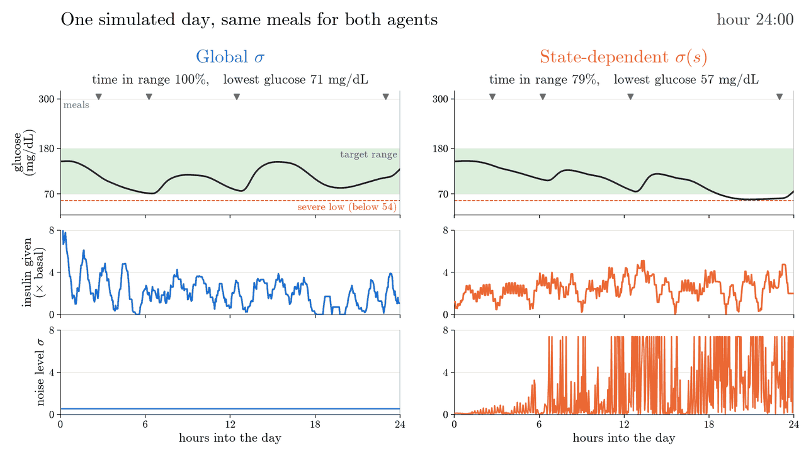

# Simglucose demo: can a human read the policy?



One simulated day, with the same meals for both agents. Top: blood glucose with the 70–180 mg/dL
target range. Middle: insulin given (30-minute average, in multiples of the patient's basal rate).
Bottom: the policy's noise level σ. Global σ is on the left, state-dependent σ(s) on the right.

* `day_100014.gif` / `.mp4`: a typical day for these two policies.
* `day_100007.gif` / `.mp4`: a bad day for σ(s), with a severe low (glucose down to 26 mg/dL).
* `policy_map.png`: what each policy does at each glucose level over 20 days: (a) the dose it means
  to give, (b) its σ, (c) how often insulin is actually given.
* `interpretability.json`: the numbers below, per day and per policy.

## The policies

Seed 1 of the main comparison (shared tuned config, `configs/tuned.json`). The checkpoints are on
the cluster, so both runs were retrained here with the study's exact command
(`scripts/sweep.py --config configs/tuned.json --config-key shared --seeds 1`). The retrained runs
are bit-for-bit the study's runs: their evaluations at 0, 252k, 502k, 752k and 999k steps match
`results/eval_curves.csv` exactly. Every number below is from 20 simulated days per policy (the
study's evaluation days, reset seeds 100000–100019), sampling actions as in the study's evaluation.

| | global σ | σ(s) |
|---|---|---|
| days meeting the clinical targets | 19 of 20 | 5 of 20 |
| days with a severe low (< 54 mg/dL) | 0 of 20 | 11 of 20 |
| insulin given when glucose is below 80 mg/dL | 0.9× basal | 3.2× basal |
| insulin given when glucose is 120–180 mg/dL | 3.0× basal | 2.0× basal |
| noise σ below 80 mg/dL / at 120–180 mg/dL | 0.57 / 0.57 | 4.5 / 0.18 |
| median intended dose below 80 / at 120–180 mg/dL | 0 / 1.4× basal | 0 / 0 |

## Is it interpretable? Yes, both policies can be read from these plots

1. *"Global σ gives less insulin when glucose is low."* **Supported.** 0.9× basal below 80 mg/dL
   vs 3.0× at 120–180 mg/dL. Its intended dose is zero below 120 mg/dL and rises to about 3.4×
   basal at 160–200 mg/dL (`policy_map.png`, panel a). It reads like a sensible controller.
2. *"Both policies stop insulin at low glucose, so the noise there is about zero"* (RESULTS.md, H4
   statement 4, which was left unchecked). **Partly supported.** The intended dose is zero in most
   steps below 80 mg/dL (68% for global σ, 61% for σ(s)), but noise still gets insulin through in
   34% (global σ) and 41% (σ(s)) of those steps.
3. *"σ(s) is careful, with a small σ, when glucose is low."* **Refuted.** Its median σ is 4.5 below
   80 mg/dL and 0.18 at 120–180 mg/dL, and it often sits at the ceiling (e² ≈ 7.4).
4. *"σ(s) gives more insulin when glucose is low than when it is in range."* **Supported for this
   run.** 3.2× vs 2.0× basal, the opposite of what is safe. It had severe lows on 11 of 20 days.
5. *"σ(s)'s intended dose follows glucose."* **Refuted.** Its median intended dose is zero at every
   glucose level (Spearman ρ = −0.04 between dose and glucose). The insulin it gives comes from the
   noise.

So σ(s) is just as readable as global σ, and what it shows is the problem: its noise is largest
exactly where extra insulin is dangerous. Its σ is not a confidence or "be careful here" signal.

**Caveats.** This is one seed per arm. Seed 1 is one of the weaker σ(s) runs: at the shared config,
σ(s) seeds 1–4 had severe lows on 18–78% of days and seeds 5–10 on at most 5%. Across the 10 σ(s)
runs, σ is larger below 100 mg/dL than above it in 7 (`results/sigma_summary.json`).

## Reproduce

```bash
# train (about 40 min per run on one CPU core); print the exact study commands with --dry-run
python scripts/sweep.py --envs simglucose-adolescent1-v0 --seeds 1 --config configs/tuned.json \
    --config-key shared --runs-root runs_demo
# demo, policy map and numbers
python analysis/simglucose_demo.py --global-run runs_demo/simglucose-adolescent1-v0/global/seed1 \
    --state-run runs_demo/simglucose-adolescent1-v0/state/seed1 --out-dir demos/simglucose
```

On Cannon the study's checkpoints are already there (`runs_final/simglucose-adolescent1-v0/{global,state}/seedN`
for the shared config, `runs_final_perarm/...` for each arm's own config), so any seed can be
rendered without retraining.
