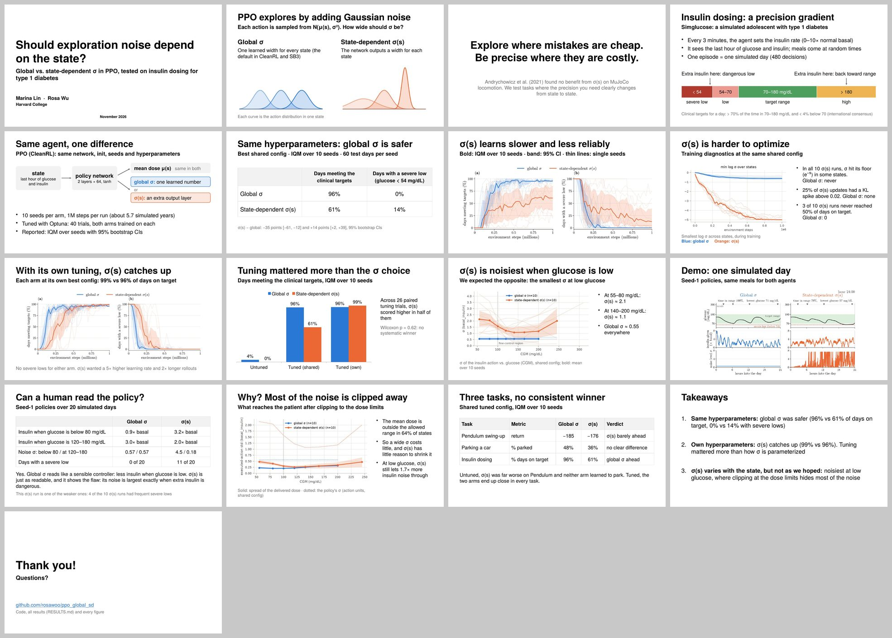

# Talk: Should exploration noise depend on the state?

A 10-minute talk (17 slides) on the study's clearest result: **Simglucose**, insulin dosing
for a simulated adolescent with type 1 diabetes. The look follows the Keynote "Basic White"
template we were given (white slides, bold Helvetica Neue titles at the top left, a bold
subtitle, few words, large figures).



| file | what it is |
|---|---|
| `talk_simglucose.pptx` | the deck, with speaker notes. Opens directly in Keynote (File → Open); File → Save then gives a `.key` |
| `talk_simglucose.pdf` | the same deck as a PDF. Rendered with LibreOffice, which uses TeX Gyre Heros in place of Helvetica Neue |
| `preview.jpg` | all slides on one page |
| `img/` | the figures used on the slides |
| `make_figures.py`, `plot_style.py`, `build_deck.js` | rebuild everything from `results/` and `figures/` |

## Why Simglucose

It is the only task with a clear gap, and the most to talk about:

* same hyperparameters: global σ meets the clinical targets on 96% of days vs 61% for σ(s),
  and σ(s) has severe lows on 14% of days (global σ: 0%);
* σ(s) is harder to optimize (σ hits its floor in 10/10 runs, KL spikes in 25% of updates);
* with its own hyperparameters σ(s) catches up (99% vs 96%), so tuning matters more than
  the parameterization;
* σ(s) does depend on the state, but it is noisiest at *low* glucose, the opposite of the
  hypothesis, because clipping at the dose limits hides most of the noise.

Pendulum (σ(s) barely ahead) and parking (no clear difference) get one summary slide.
Every number on the slides is from `RESULTS.md` and `results/*.md`. The speaker notes give
the confidence intervals.

## Outline (≈ 10 min)

1. Title
2. PPO explores by adding Gaussian noise: global σ vs state-dependent σ(s)
3. The bet: explore where mistakes are cheap, be precise where they are costly
4. Insulin dosing: a precision gradient (the task and the glucose ranges)
5. Same agent, one difference (setup: 10 seeds, 1M steps, 40 tuning trials)
6. Same hyperparameters: global σ is safer (96% vs 61%, 0% vs 14%)
7. Learning curves at the shared config
8. σ(s) is harder to optimize (σ floor, KL spikes, runs that never learn)
9. With its own tuning, σ(s) catches up
10. Tuning mattered more than the σ choice (all three settings)
11. σ(s) is noisiest when glucose is low
12. Demo: one simulated day (animated GIF; plays in Keynote and PowerPoint)
13. Can a human read the policy? (numbers behind the demo)
14. Why: most of the noise is clipped away
15. Three tasks, no consistent winner
16. Takeaways
17. Thank you / questions

## Figures

* **Panels cut from the study's figures** (`figures/simglucose-adolescent1-v0_*.png`):
  `sigma_vs_cgm.png` (from `_sigma_binned`), `executed_noise_vs_cgm.png` (`_effective_noise`)
  and `min_logsigma.png` (`_diagnostics`).
* **Demo**: `demo_day.gif`, the slide version of `demos/simglucose/day_100014.gif`, made by
  `analysis/simglucose_demo.py` (see `demos/simglucose/README.md` for the interpretability check).
* **Redrawn with slide-sized text**: `curves_shared.png` and `curves_perarm.png`, from
  `results/eval_curves.csv`, with the same statistics as `analysis/curves.py` (IQM over 10 seeds,
  95% bootstrap band, thin lines for single seeds). The original curves figure is an 8-panel
  strip that is unreadable on a slide.
* **Illustrations**: `noise_global.png`, `noise_state.png`.

## Rebuild

From the repository root:

```bash
python slides/make_figures.py   # matplotlib, pandas, scipy, Pillow
node slides/build_deck.js       # needs pptxgenjs: npm install pptxgenjs
```

To remake the PDF: `soffice --headless --convert-to pdf --outdir slides slides/talk_simglucose.pptx`,
or export from Keynote (File → Export To → PDF) to get the real fonts.
